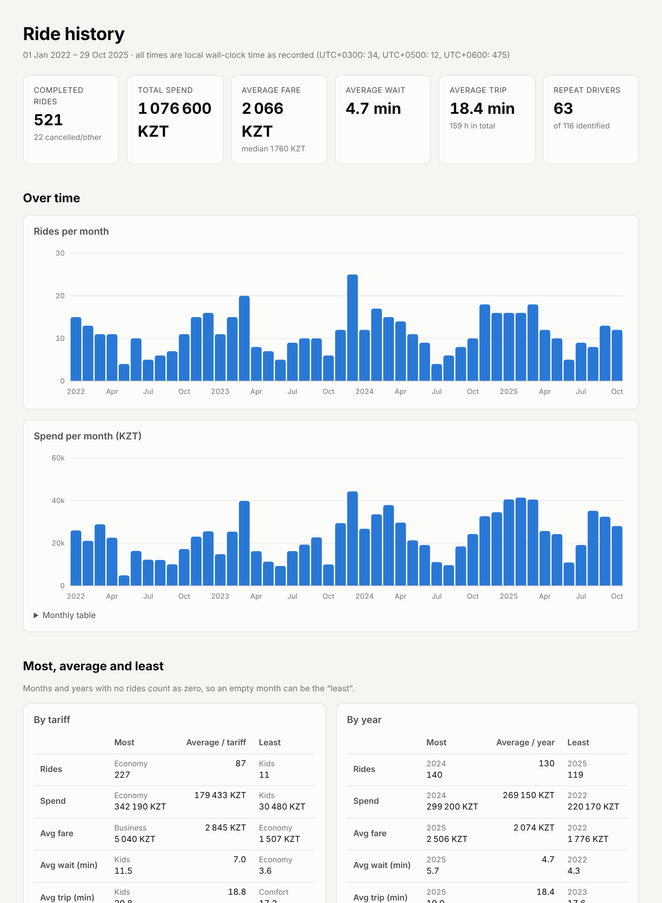

# taxistats

**What do four years of taxi rides say about how I get around?**

`taxistats` is a small, tested Python pipeline that takes several Yandex Go
ride-history exports (JSON), merges and de-duplicates them, and answers a set
of plain questions about the rides. It produces a self-contained HTML
dashboard, a clean CSV, and a JSON summary.

My real ride history is personal data and is **not in this repository**.
Everything you see here was produced from a **synthetic dataset** with the
same structure, generated by code in this repo with a fixed seed.



---

## Contents

- [The questions](#the-questions)
- [Quick start](#quick-start)
- [The data](#the-data)
- [Pipeline](#pipeline)
- [Methods and design choices](#methods-and-design-choices)
- [Privacy](#privacy)
- [Project layout](#project-layout)
- [Limitations and next steps](#limitations-and-next-steps)

---

## The questions

1. **Where does the money go?** Total and average spend, and the most and
   least expensive rides.
2. **Which tariff do I use most, and what does each one cost me?** Rides, share,
   spend and min/mean/max fare, wait and trip time for each tariff.
3. **How does it change over time?** Most, average and least by **month** and
   by **year**, for ride count, spend, average fare, wait and trip length.
4. **When do I ride?** By weekday and by hour of the day, in local time.
5. **Do I keep getting the same drivers or cars?** Repeat drivers (same name
   *and* plate), repeat cars (same plate, possibly different drivers), and
   repeat names (weaker evidence, see below).
6. **How trustworthy is the merged data?** How many duplicates were merged, how
   many copies of the same order disagreed, and how many records were rejected.

On the synthetic sample (4 files, 705 raw records), the pipeline gives:

| | |
|---|---|
| Unique orders after merging | 543 (161 duplicates merged, 5 field conflicts, 1 malformed record rejected) |
| Completed rides | 521 · total 1 076 600 KZT · mean fare 2 066 KZT, median 1 760 KZT |
| Most / least used tariff | Economy (227 rides) / Kids (11) · average 87 per tariff |
| Busiest / quietest month | Dec 2023 (25 rides) / May 2022 (4) · average 11.3 per month |
| Drivers | 116 identified on 279 rides; 63 of them seen more than once |

The sample is synthetic, so these numbers only show what the pipeline does.
They are not findings.

---

## Quick start

Requires Python ≥ 3.10.

```bash
python -m venv .venv && source .venv/bin/activate
```

```bash
pip install -e ".[dev]"
```

```bash
taxistats run data/sample
```

Then open `output/dashboard.html` in a browser. To regenerate the synthetic
sample (deterministic for a given seed):

```bash
taxistats sample --out data/sample --seed 42
```

To run the tests:

```bash
pytest
```

### On your own export

Put the JSON files you downloaded into `data/raw/` (git-ignored) and run:

```bash
taxistats run data/raw --out output
```

`run` accepts any mix of files and folders, and searches folders recursively
for `*.json`. Add `--anonymise` to replace driver names and plates with stable
pseudonyms (`Driver 001`, `CAR 001`) when you want a dashboard you can share.
`-v` logs every rejected record.

Enable the pre-commit guard once per clone (see [Privacy](#privacy)):

```bash
git config core.hooksPath .githooks
```

---

## The data

Each export file contains a list of orders. The synthetic files in
[`data/sample/`](data/sample) look like this:

```json
{
  "export_created": "2025-10-31T23:59:00+0600",
  "orders": [
    {
      "id": "3f0c…",
      "created": "2025-10-29T08:42:17+0600",
      "status": "complete",
      "tariff": "comfortplus",
      "cost": 2860.0,
      "currency": "KZT",
      "waiting_time": 212,
      "duration": 1384,
      "performer": {
        "name": "Arman K.",
        "car": { "model": "Toyota Camry", "color": "white", "number": "482KTA02" }
      }
    }
  ]
}
```

| Field | Notes |
|---|---|
| `created` | Local time **with offset**, e.g. `+0600`. `+06:00`, fractional seconds and `dd.mm.yyyy` are also accepted. |
| `tariff` | Tariff or class code, mapped to a display name (`comfortplus` → `Comfort+`). |
| `cost` | A number, a string like `"1 450 ₸"`, or `{value, currency}`. |
| `waiting_time`, `duration` | Seconds. Reported in minutes. |
| `performer` | Driver and car. **Present on some rides only.** |

The parser looks fields up through a table of aliases
(`schema.FIELD_ALIASES`), so it tolerates different key names and nesting.
If a real export names things differently, that table is the one place to
change; the rest of the pipeline does not touch raw keys.

### What the synthetic data reproduces

The generator ([`synthetic.py`](src/taxistats/synthetic.py)) does not try to
reproduce real price levels. It does reproduce the problems the pipeline has
to handle:

- **Overlapping export windows.** Four files, each overlapping the previous
  one, so many orders appear twice.
- **Late enrichment.** Rides near the end of an older export sometimes lack
  driver details that the next export includes.
- **Conflicting copies.** About 2% of duplicated rides have a slightly lower
  cost in the older file, as if an estimate had been replaced by the final
  price.
- **Mixed UTC offsets.** Most rides are `+0600`; some were recorded while
  travelling (`+0300`, `+0500`).
- **Partial and repeating driver data.** Driver details are present on 35–80%
  of rides, rising over time. A few "regular" drivers sit on top of a long
  tail. Some drivers change cars, and some display names are shared by
  different people.
- **Seasonality and daily rhythm.** More rides in winter and at weekends, and
  commute peaks on weekdays.
- **One malformed record** with no timestamp.

---

## Pipeline

```
 data/raw/*.json ──► discover ──► extract ──► parse ──► merge & dedupe ──► DataFrame ──► stats ──► outputs
                     (recursive)  (any nesting) (Ride)   (id → fingerprint,             (pandas)    rides.csv
                                                          field coalescing)                         summary.json
                                                                                                    dashboard.html
```

| Module | Responsibility |
|---|---|
| [`schema.py`](src/taxistats/schema.py) | The only module that knows about raw keys. Parses timestamps, money and durations into a frozen `Ride` dataclass. |
| [`load.py`](src/taxistats/load.py) | Finds files, extracts order lists from any reasonable nesting, merges and de-duplicates, and builds a `LoadReport`. |
| [`stats.py`](src/taxistats/stats.py) | Pure functions from DataFrame to DataFrame or dict: breakdowns, most/average/least, extremes, repeats. |
| [`dashboard.py`](src/taxistats/dashboard.py) | Renders HTML with inline SVG charts. No templates and no JS libraries. |
| [`pipeline.py`](src/taxistats/pipeline.py) | Runs the steps in order, with optional anonymisation, and writes the outputs. |
| [`synthetic.py`](src/taxistats/synthetic.py) | Deterministic generator for the sample data. |
| [`cli.py`](src/taxistats/cli.py) | `taxistats sample` and `taxistats run`. |

---

## Methods and design choices

### 1. Local time is the clock that matters

A ride at `08:15+0600` was a morning commute, wherever UTC says it was. Month,
weekday and hour buckets therefore use the **wall-clock time as written in the
export**. A ride at `00:30+0600` on 1 February counts in February, although it
is still 31 January in UTC (this is tested). The UTC instant is kept alongside
for sorting and for de-duplication.

Timestamps without an offset are **rejected**, not assumed to be local.
Guessing an offset would silently break de-duplication across files.

### 2. De-duplication: id first, then a fingerprint, then coalescing

Overlapping exports mean the same order can appear several times, and the
copies are not always identical. The merge works in three steps:

1. **Order id** is the primary key.
2. Records with no id fall back to a **fingerprint**: UTC instant to the
   minute, tariff and rounded cost. The fingerprint uses UTC so that the same
   instant written as `+0600` in one file and `+0500` in another still
   matches. An id-less copy can also attach to an id'd ride from another file.
3. **Field-level coalescing.** Rather than "first copy wins", copies are
   ranked by how many fields they fill in (ties go to the later export), and
   each field takes the first non-empty value. A driver name missing from the
   old export is filled in from the new one. When two copies disagree on a
   filled-in field, the disagreement is **counted and reported** as a
   conflict, not hidden.

Every merged ride records which files it came from (`source_file`), so any
number can be traced back to its source.

### 3. "Least" includes zero

Monthly and yearly tables are reindexed over the full calendar span. A month
with no rides gets a row with 0, so it can be the "least" month. Without this,
the quietest month would be the quietest *non-empty* month, which is a
subtly different question. Tariff tables are not reindexed, because there is
no meaningful set of tariffs I never used.

### 4. Completed rides only, one currency only

Cancelled orders have no meaningful fare or trip time. They are counted in
the overview and excluded from everything else. If rides were paid in several
currencies (for example while travelling), money figures use the most common
currency and the dashboard says how many rides were left out. Summing tenge
and roubles would produce a number that means nothing.

### 5. Driver identity is approximate, so evidence is graded

A display name like "Arman K." is not an identity, because many drivers share
it. The analysis therefore separates three levels of evidence:

| Table | Key | Strength |
|---|---|---|
| Repeat drivers | name **+** plate | Strong: same name in the same car |
| Repeat cars | plate | Strong for the car; lists every name seen driving it |
| Repeat names | name only | Weak: shows how many distinct cars each name had |

The synthetic data includes both kinds of ambiguity: drivers who change cars,
and different drivers who share a name.

### 6. Leniency at the edges, strictness inside

The parser accepts several timestamp formats, money as a number, string or
object, a BOM at the start of a file, and order lists nested under `orders`,
`data` or `rides`. Once a `Ride` exists, though, it is typed and immutable.
Bad records raise `RecordError` and are counted per file, rather than
crashing the run or disappearing silently.

### 7. A dashboard that makes no network requests

The dashboard is one HTML file. Charts are inline SVG generated in Python;
CSS and the roughly 10-line tooltip script are inline. Opening it never tells
a CDN that you are looking at your personal data, and it works offline.

- **Every chart has a table.** Tooltips add detail but never hold the only
  copy of a value.
- **One series per chart**, in a single colour, with recessive gridlines.
  Rides and spend are separate charts rather than a dual-axis chart.
- **Light and dark themes** follow the operating system, and the layout
  works on a phone.
- **All values are HTML-escaped**, because the export is untrusted input,
  driver names included.

### 8. Testable pieces

Each stats function is a pure function of a DataFrame, so tests build tiny
frames by hand and check exact values. The 30 tests cover timestamp and money
parsing, every de-duplication path (id, cross-offset fingerprint, id-less to
id'd, conflicts, enrichment), zero-filled months, local-time bucketing,
currency exclusion and graded driver matching. An end-to-end test checks that
the dashboard makes no external requests and that `--anonymise` leaks no
original name or plate into any output.

---

## Privacy

This project exists to analyse personal data that must never reach GitHub. It
uses three layers of protection:

1. **`.gitignore` is deny-by-default for data.** Everything under `data/` is
   ignored except `data/sample/`. Folders named like an export (`raw/`,
   `private/`, `exports/`, `*Yandex*/`, `*ride*history*/`…) are ignored
   anywhere in the tree, as are archives (`*.zip`, `*.7z`…) and the `output/`
   folder.
2. **A pre-commit hook** ([`.githooks/pre-commit`](.githooks/pre-commit))
   rejects any staged `.json`, `.csv`, archive or `dashboard.html` outside
   `data/sample/` and `tests/`, even if it was force-added with `git add -f`.
   Enable it with `git config core.hooksPath .githooks`.
3. **Outputs are treated as private.** The CSV, JSON and dashboard contain
   driver names and plates, so they go to the ignored `output/` folder. The
   `--anonymise` flag swaps names and plates for consistent pseudonyms, which
   keeps the repeat-driver analysis intact.

The screenshot in this README and everything in `data/sample/` come from
synthetic data.

---

## Project layout

```
taxistats/
├── src/taxistats/      # the package (see Pipeline)
├── tests/              # pytest suite
├── data/
│   ├── README.md
│   └── sample/         # synthetic exports — the only committed data
├── docs/dashboard.png  # screenshot from the synthetic sample
├── .githooks/          # pre-commit privacy guard
├── .gitignore
└── pyproject.toml
```

---

## Limitations and next steps

- **The schema is inferred, not documented.** Yandex does not publish a
  format for ride-history exports. The field aliases cover the structure
  described above, but a different export version may need new aliases in
  `schema.FIELD_ALIASES`.
- **Driver identity is a heuristic.** Name plus plate is good evidence, not
  proof.
- **No route or location analysis.** Pickup and drop-off addresses are the
  most sensitive part of the data, and I left them out on purpose.
  Aggregating them, for example "top destinations by district", would be a
  natural next step and should come with coarser rounding.
- **Price is not inflation-adjusted.** Year-on-year fare changes mix real
  price rises with changes in tariff mix and trip length. Normalising cost per
  minute within each tariff would separate those effects.
